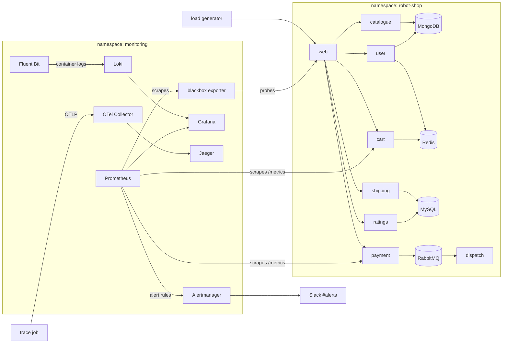
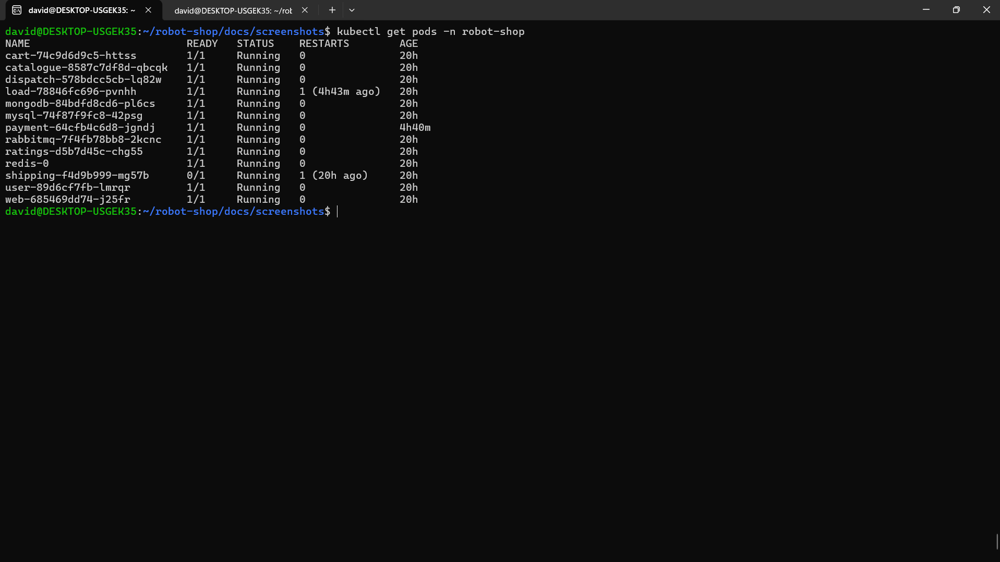
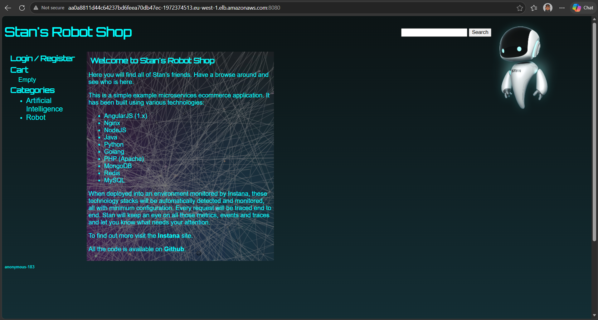
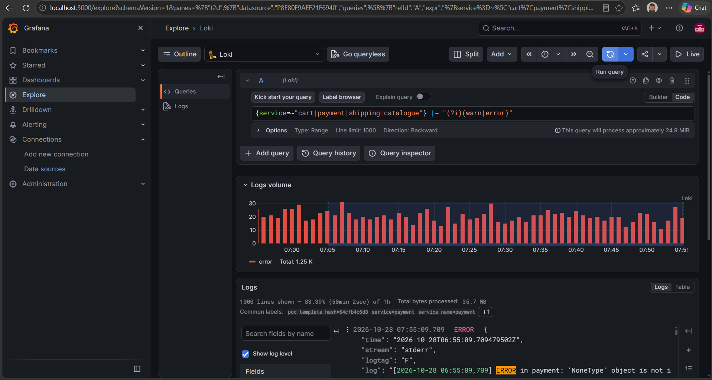
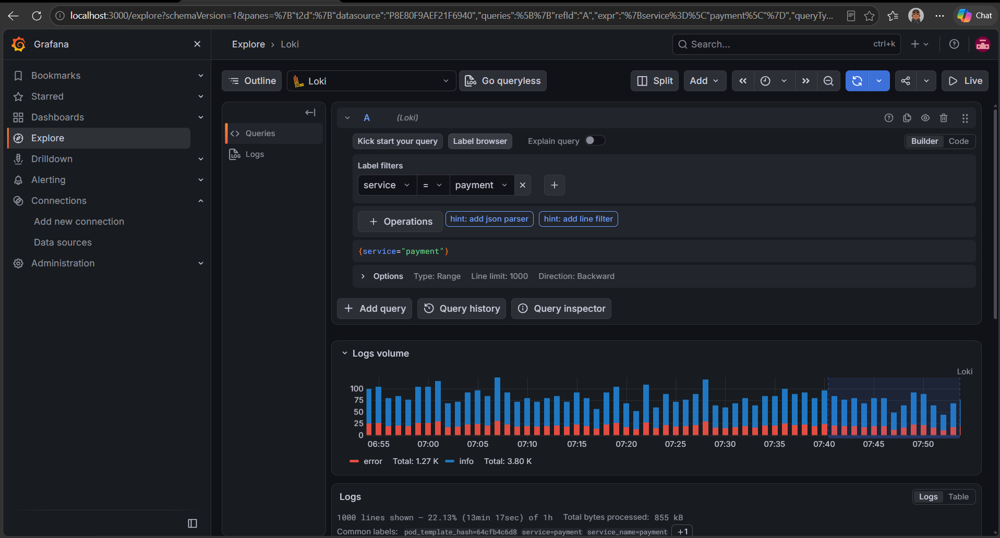
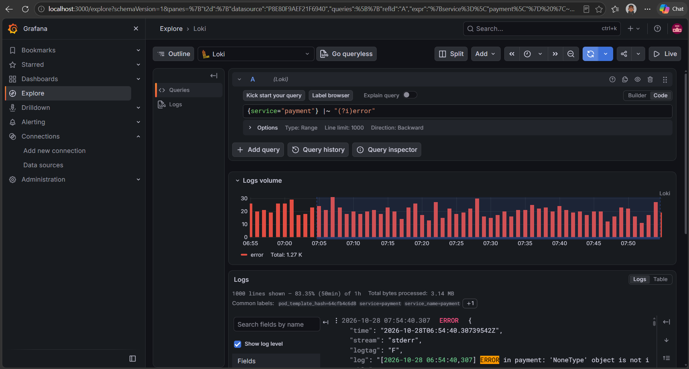
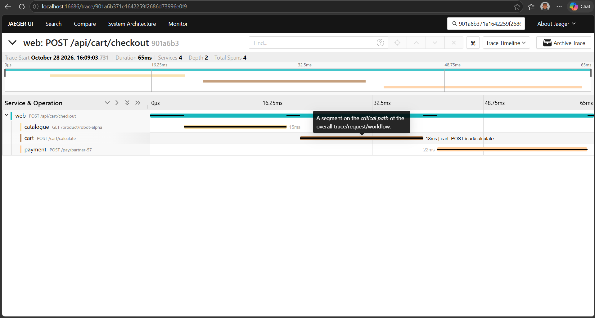
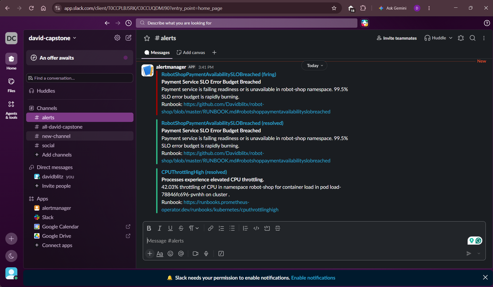

# Capstone 2: Keep It Running (Stan's Robot Shop)

Fork of [instana/robot-shop](https://github.com/instana/robot-shop). The shop runs on the EKS cluster built in [Capstone 1](https://github.com/Davidblitx/example-voting-app) and is wrapped in monitoring: metrics, logs, a trace, an SLO with a Slack alert, a runbook, and a failure drill with a postmortem.

## Starting point and what I changed

The Loki, Fluent Bit, OpenTelemetry Collector, Jaeger, alert-rule and dashboard files started from a community starter kit that the cohort moderator shared with the instructor's approval. Everything else is my own work. My changes:

- Removed the Instana agent and EUM settings from the Robot Shop Helm chart, because there is no Instana agent in this cluster
- Switched the Redis StatefulSet to an `emptyDir`, because the cluster has no EBS CSI driver and the original `standard` volume would never bind
- Replaced the kit's dashboard (network, CPU, memory, restarts) with one built around requests, errors and latency
- Added a blackbox `Probe` and a `ServiceMonitor` so the dashboard has real data
- Added the ConfigMap the tracing job needs, which the kit did not include
- Pointed the runbook links at my repository, wired the alerts to Slack, and wrote the runbook, SLO document and postmortem
- Ran my own failure drill and recorded my own timings

## Architecture



## Repository layout

| Path | Purpose |
|---|---|
| `K8s/helm/` | Robot Shop Helm chart (Instana settings removed, Redis on `emptyDir`) |
| `K8s/load-deployment.yaml` | Load generator (15 clients) |
| `observability/monitoring/` | Blackbox `Probe` and `ServiceMonitor` |
| `observability/dashboards/` | Dashboard JSON, its ConfigMap, and the script that generates both |
| `observability/logging/` | Loki, Fluent Bit, Grafana Loki data source |
| `observability/tracing/` | Jaeger, OTel Collector, verification job and its script ConfigMap |
| `observability/alerts/` | Prometheus alert rules and an example Alertmanager Slack config |
| `RUNBOOK.md` | What to do for each alert |
| `docs/SLO.md` | SLI, SLO, error budget and error budget policy |
| `docs/POSTMORTEM.md` | Blameless postmortem of my drill |

## How to rebuild

The cluster comes from Capstone 1 (`terraform apply`). Then:

```bash
aws eks update-kubeconfig --name david-capstone-cluster --region eu-west-1

helm repo add prometheus-community https://prometheus-community.github.io/helm-charts
helm repo update
helm install prometheus prometheus-community/kube-prometheus-stack -n monitoring --create-namespace
helm install blackbox prometheus-community/prometheus-blackbox-exporter -n monitoring

helm install robot-shop K8s/helm -n robot-shop --create-namespace
kubectl apply -n robot-shop -f K8s/load-deployment.yaml

kubectl apply -f observability/logging/
kubectl apply -f observability/monitoring/probe-and-scrape.yaml
kubectl apply -f observability/dashboards/dashboard-configmap.yaml
kubectl apply -f observability/alerts/robot-shop-slo-rules.yaml
kubectl apply -f observability/tracing/jaeger.yaml -f observability/tracing/otel-collector.yaml
kubectl apply -f observability/tracing/trace-script-configmap.yaml -f observability/tracing/trace-job.yaml
```

The Prometheus release must be named `prometheus` and live in `monitoring`. The alert rules carry `release: prometheus` and the Loki ruler points at that Alertmanager.

## Step 1: Deploy and watch

Robot Shop runs in the `robot-shop` namespace: 12 services (the web front end, catalogue, cart, user, payment, shipping, ratings, dispatch, and the MongoDB, MySQL, Redis and RabbitMQ data stores) plus the load generator. All 13 pods are `Running`, and the load generator keeps 15 clients sending traffic.




## Step 2: Metrics

Prometheus, Alertmanager and Grafana come from `kube-prometheus-stack` (chart 92.14.1, release `prometheus`, namespace `monitoring`).

None of Robot Shop's services expose request-rate or latency metrics. Only cart (`items_added`) and payment (`sold_count_total`) expose business counters, and the rest return no `/metrics`. So the dashboard measures from the outside:

- **Availability, errors, latency:** a blackbox exporter probes three web endpoints every 15 seconds (`probe_success`, `probe_http_status_code`, `probe_duration_seconds`)
- **Requests:** throughput from the cart and payment counters
- **Health:** payment and web pod readiness, and pod restarts

These are proxies for user requests, not a measurement of them. The dashboard is exported as code: the JSON, a ConfigMap that Grafana's sidecar loads, and `gen_dashboard.py`, which produces both.



## Step 3: Logs

Fluent Bit runs as a DaemonSet, reads the container logs on each node, and ships them to Loki with the pods' Kubernetes labels. Logs can be searched by service and by level in Grafana Explore:

- `{service="payment"}`
- `{service="payment"} |~ "(?i)error"`




Baseline: the payment service logs `'NoneType' object is not iterable` about 1,270 times an hour while it is healthy, which comes from the load generator. So log error counts are not used as an SLI.

## Step 4: One trace

Jaeger (all-in-one) and an OpenTelemetry Collector run in `monitoring`. Robot Shop's services are built for Instana and are not instrumented for OpenTelemetry. So I used the kit's verification job, which builds a synthetic checkout trace (web, catalogue, cart, payment) and sends it by OTLP to the collector. The collector forwards it to Jaeger, and Jaeger shows one trace with 4 spans (trace ID `901a6b371e1642259f2686d73996e0f9`).

This proves the pipeline from collector to Jaeger. It does not show a real request that Robot Shop emitted.



## Step 5: SLO, error budget and alert

Full details are in [docs/SLO.md](docs/SLO.md).

| Service | SLI | SLO (30 days) | Error budget |
|---|---|---|---|
| Payment | At least one ready payment pod | 99.5% | 216 minutes |
| Web | Successful HTTP probes | 99.0% | 432 minutes |

Three alert rules exist: payment and web availability (no ready pod for 30 seconds) and a high crash-loop rate. Each carries a `runbook_url` that points to the matching section of [RUNBOOK.md](RUNBOOK.md). Alertmanager sends alerts to Slack. The webhook URL is kept out of Git; `observability/alerts/alertmanager-values.example.yaml` shows the configuration with a placeholder.

## Step 6: Incident drill

I ran my own drill: I scaled the payment deployment to zero, watched the alert arrive in Slack with its runbook link, mitigated by scaling back up, and saw the resolved message.

| Event | Time (local) |
|---|---|
| Fault injected | 15:39:35 |
| Mitigation started | 15:40:48 |
| Alert in Slack | about 15:41 |
| Recovered | 15:46:28 |

Outage: about 6 minutes 53 seconds, using about 3.2% of the payment error budget. See [docs/POSTMORTEM.md](docs/POSTMORTEM.md) for the timeline, what went wrong and the action items.



## Known limitations

- **Nothing is persistent.** Loki, Redis and Prometheus use `emptyDir`, so their data is lost if a pod restarts, and a 30-day SLO cannot be queried historically.
- **Proxy metrics.** The web SLI comes from probes and the payment SLI from pod readiness, not from real request counts.
- **Synthetic trace.** The trace shows the pipeline works, not that Robot Shop is instrumented.
- **Single replicas.** Every service has one pod, so a pod loss is an outage, as the drill showed.
- **No burn-rate alerts.** The alerts fire on a hard readiness failure and detect budget burn late.
- **Noise.** The default `CPUThrottlingHigh` rule fires for the load generator pod.
- **The web service is public.** The chart creates an AWS load balancer for it. Uninstall the release before destroying the cluster.
- **Long-lived secret.** The Slack webhook is long-lived and must be revoked after use.

## Clean up

```bash
helm uninstall robot-shop -n robot-shop
# then run terraform destroy in the Capstone 1 repository
```
